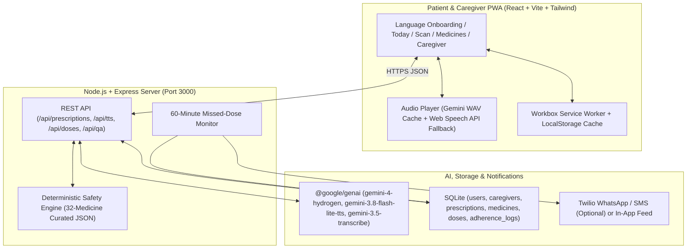

# MediSathi — Voice-First Multilingual Prescription Companion

MediSathi helps patients in rural and semi-urban India understand and safely follow handwritten or English prescriptions. It turns a prescription photo into editable, verified medicine cards, 6th-grade plain-language spoken explanations (**English, Hindi, Assamese, and Bengali**), a Morning/Afternoon/Night schedule with reminders, curated safety checks, and 60-minute caregiver missed-dose alerts.

---

## Setup in Under 5 Minutes

1. **Install dependencies**
   ```bash
   npm install
   ```
2. **Configure environment**
   Copy `.env.example` to `.env` and set your Gemini API key:
   ```bash
   cp .env.example .env
   ```
   - `GEMINI_API_KEY`: Required for live prescription scanning, translation, TTS, and voice Q&A.
   - `DEMO_MODE=true` *(optional)*: Uses pre-computed cached responses for offline/hackathon demos.
   - `TWILIO_ACCOUNT_SID`, `TWILIO_AUTH_TOKEN`, `TWILIO_WHATSAPP_FROM` / `TWILIO_SMS_FROM` *(optional)*: Enables live WhatsApp/SMS caregiver alerts; otherwise alerts appear in the in-app Caregiver Alert Feed.
3. **Run the full-stack app**
   ```bash
   npm run dev
   ```
   Open `http://localhost:3000`.
4. **Build for production**
   ```bash
   npm run build
   npm start
   ```

---

## Architecture Diagram



---

## Key Deliverables & Folders

- `/prompts/` — Exact LLM system prompts (`extract-prescription.md`, `explain-medicine.md`, `answer-question.md`).
- `/data/medicines_safety.json` — Curated 32-medicine Indian primary-care dataset with active ingredients, cautions, and drug-drug interaction rules.
- `/data/sample_prescriptions.json` — Pre-computed fallback data for 3 realistic sample prescriptions (`/public/samples/*.jpg`).
- `/DEMO_SCRIPT.md` — 3-minute live demo walkthrough.

---

## Known Limitations & Responsible AI Boundaries

- **Not a medical device**: MediSathi never diagnoses conditions, recommends starting/stopping medicines, or alters prescribed doses. Every explanation displays and speaks *"Please confirm with your doctor or pharmacist."*
- **Curated safety scope**: Automatic interaction and duplicate checks cover the 32 common Indian medicines in `/data/medicines_safety.json`. Any medicine outside this dataset is explicitly labeled **"Not checked"** rather than assumed safe.
- **OCR verification required**: Handwritten prescriptions can be ambiguous. Low-confidence items are flagged for manual patient/caregiver verification before saving.
- **Regional TTS fallback**: When offline or if Gemini TTS is unavailable, the browser's `speechSynthesis` is used; Assamese voice availability varies by Android TTS engine and gracefully falls back to Bengali/Hindi voices on device.
- **Single-tenant hackathon seed**: Seeded with one demo patient (`Ramesh Das`) and caregiver (`Meera Das`) for rapid demonstration; multi-user authentication is out of scope for this MVP.
